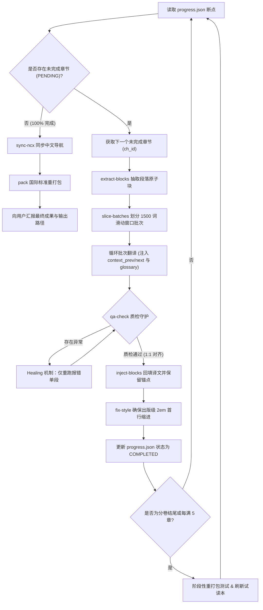

# EPUB 电子书专业翻译技能规范 (epub-translator)

本 Skill 专为整本大部头长篇著作设计，彻底解决**长文翻译中的上下文割裂、中文首行缩紧/缺缩进排版混乱、漏段吞字、术语漂移、代词混淆、排版损坏与阅读器兼容性**等难题。

---

## 🏗 工具链说明

本 Skill 内置纯 Python 3 原生标准库实现的 CLI 辅助工具，零第三方外部依赖：
- 脚本位置：`scripts/epub_tool.py`
- 支持子命令：
  - `unpack <epub> <work_dir>`：解包 EPUB，解析 `container.xml`、`content.opf`，输出 `book_info.json` 与断点追踪 `progress.json`。
  - `extract-blocks <xhtml> -o <blocks.json>`：安全抽取章节内段落与标题标签（`p`, `h1-h6`, `li`, `blockquote` 等），建立原子索引。
  - `slice-batches <blocks.json> <out_dir> [--max-words 3000] [--max-blocks 50]`：**智能批次切片引擎**。按 2,500 ~ 3,500 词自动划分批次（默认 3,000 词），大幅降低往返通信轮次并封装**三层滑动窗口上下文**（前序末尾 2 段 + 后续起始 1 段）。
  - `inject-blocks <xhtml> <trans.json> <out_xhtml> [--mode bilingual|mono] [--indent 2em|1em]`：回填译文，注入深色/浅色自适应高雅排版样式。自动注入**中文出版级首行缩进（默认 2em 即空 2 个汉字字符，中国图书出版标准）**，智能豁免各级标题、引言块、居中段落、插图及表格。自动保留原书各级标题的内嵌层级样式包裹标签（`<span class="bold">`、`<span class="italic">` 等），确保排版视觉阶梯感与原书完全一致。
  - `fix-style <work_dir> [--mode mono|bilingual] [--indent 2em|1em]`：**全局排版样式修复引擎**。在 EPUB 的所有全局 CSS 样式表（`stylesheet.css` 等）中追加出版级中文段落排版规则，确保各类阅读器（Apple Books、微信读书、Kindle 等）强制生效标准 2 字符（2em）缩进与舒适行距。
  - `qa-check <src.json> <trans.json>`：**程序化硬性质检**。检验索引数量 1:1 对齐、字符长度离群值（防漏译/复读）、关键数字与年代遗失检测，自动输出单段纠错清单。
  - `glossary-scan <work_dir> -c 5`：扫描全书前序章节，提取高频大写专有名词与核心金融/科技概念。
  - `sync-ncx <work_dir> <toc_trans.json> [--title "..."]`：**底层导航目录同步**。将翻译后的章节名称同步刷入 `toc.ncx` / `nav.xhtml`，确保阅读器自带的侧边栏/弹出式原生系统目录 100% 显示纯中文。
  - `pack <work_dir> <out.epub>`：严格按国际标准打包（`mimetype` 首位无压缩存储），确保各类阅读器完美兼容。

---

## ✒️ 核心翻译与文学重塑准则

### 1. 优先忠于原文与修辞还原（Faithful to the Original）
- **尊重原作风貌**：严谨尊重原作者的句子结构、逻辑脉络与行文节奏。
- **还原标点修辞**：对原文中的破折号、插入语与语调停顿，优先忠于原文修辞进行准确传译，不擅自拆解、随意删减或过度重写作者的句式，完整保留原书的情感张力与思想深度。
- **去翻译腔**：在忠于原文的基础上摆脱生硬的欧化语病，保持中文母语表达的通畅自然。

### 2. 出版级中文排版规范（Chinese Typography）
- **正文首行缩进**：默认采用**中国图书出版国家标准（GB/T 15834）经典规范——首行缩进 2 个汉字字符（`text-indent: 2em !important;`）**，段落边界清晰分明；亦可通过 `--indent 1em` 灵活切换为小屏幕紧凑版。
- **豁免白名单**：标题（`h1-h6`、`.title`、`.chapter-title`）、引文块（`blockquote`）、列表项（`li`）、表格（`td/th`）、居中行（`.center`）与图文插图（`p:has(img)`、`.illustration`）严格禁止首行缩进（`text-indent: 0 !important;`）。

---

## 🚀 工业级防错翻译工作流 (5 阶段 SOP)

### 阶段一：解构、建立索引与全书断点初始化
```bash
python3 scripts/epub_tool.py unpack "<input.epub>" "<work_dir>"
```
- 查看 `<work_dir>/book_info.json` 与 `<work_dir>/progress.json`。
- 明确章节总数、各章节排版文件路径及总字数。

### 阶段二：前置术语库扫描与试译风格确认
1. 运行 `python3 scripts/epub_tool.py glossary-scan "<work_dir>" -c 5` 抽取核心词表。
2. 提取开篇 15~20 个段落，展示**【风格 A：专业严谨版】**与**【风格 B：通俗流畅版】**供用户选定。
3. 确认版式需求：**双语对照（bilingual，默认）** 还是 **纯中文替换（mono）**。

### 阶段三：智能切片与滑动窗口批次翻译
按 Spine 章节顺序循环执行：
1. 提取章节块：
   ```bash
   python3 scripts/epub_tool.py extract-blocks "<xhtml_path>" -o "<work_dir>/cache/<ch_id>_blocks.json"
   ```
2. 智能切片生成滑动窗口任务：
   ```bash
   python3 scripts/epub_tool.py slice-batches "<work_dir>/cache/<ch_id>_blocks.json" "<work_dir>/cache/<ch_id>_batches"
   ```
3. **调用翻译模型**：
   - 载入批次任务文件中的 `context_prev` 与 `context_next`，保障语境自然过渡；
   - 注入静态锁死的术语映射表（Glossary）；
   - 执行严苛负向约束：坚持**优先忠于原文**，忠实传达作者修辞，严禁合并段落，严禁汉化链接或专有标记，输出严格 JSON 数组格式。

### 阶段四：硬性质检守门与单段自动纠错 (QA & Healing)
合并当前章节所有批次译文后，执行：
```bash
python3 scripts/epub_tool.py qa-check "<work_dir>/cache/<ch_id>_blocks.json" "<work_dir>/cache/<ch_id>_trans.json"
```
- 若 `passed: false`：读取报告中的 `healing_items`，**仅对出错的几个段落进行单段纠错重跑**，修正后合并回主文件，避免无谓重译全批次。

### 阶段五：DOM 重构注入、样式全局修复与标准打包
1. 注入译文并添加出版级排版样式：
   ```bash
   python3 scripts/epub_tool.py inject-blocks "<raw_xhtml>" "<trans.json>" "<raw_xhtml>" --mode mono
   ```
2. 全局样式表注入 2em 首行缩进与行距（防止原书 CSS 覆盖）：
   ```bash
   python3 scripts/epub_tool.py fix-style "<work_dir>" --mode mono
   ```
3. 同步底层系统阅读器目录（NCX/NAV）：
   ```bash
   python3 scripts/epub_tool.py sync-ncx "<work_dir>" "<toc_trans.json>" --title "书名"
   ```
4. 更新 `<work_dir>/progress.json` 章节完成状态。
5. 全部章节完成后，规范化打包生成目标 EPUB：
   ```bash
   python3 scripts/epub_tool.py pack "<work_dir>" "<output_translated.epub>"
   ```

---

## 🤖 /goal 长程自主全书全自动流水线（Autonomous Goal Pipeline）

当面对数十万字、数十至上百个章节的大部头巨著时，用户可在聊天框输入 `/goal` 命令启动**全自动无人值守长程流水线（Overnight Task）**。Agent 将依据 `progress.json` 自动维持状态机循环，直到全书 100% 翻译、质检与打包完成。

### 1. 标准触发指令规范
```markdown
/goal 使用 epub-translator 技能规范，在工作目录 <work_dir> 中，读取 progress.json 进度断点，以【风格 A：典雅严谨·非虚构史诗版】和【纯中文出版级排版 mono】模式，按 Spine 章节顺序循环执行未完成章节：智能滑动窗口分批切片、深度翻译、QA 硬性质检纠错、DOM 注入与 progress.json 状态回写。每完成一个分卷（Part）或每 5 个章节自动进行阶段性重打包测试，直至全书所有章节 100% 翻译完成并输出最终 EPUB 电子书。
```

### 2. 自主状态机运转机制 (Autonomous Loop)


### 3. 断点续译与抗崩溃机制
- **零重复翻译**：每次启动或中断恢复时，Agent 严格读取 `progress.json` 的 `chapters_status`，已标记为 `COMPLETED` 的章节直接跳过；
- **批次缓存隔离**：各章节的原子切片与翻译结果分别暂存于 `<work_dir>/cache/<ch_id>_trans.json`，即使网络波动或进程暂停，数据绝对安全；
- **阶段性成果落盘**：每完成一个核心分卷（如 Part I, Part II）或每翻译 5 个章节，自动调用 `epub_tool.py pack` 生成当前最新的增量试读本，随时可供用户在阅读器中检阅。

---

## ⚡ 性能优化与高吞吐全速流水线规范 (High-Throughput Best Practices)

为避免大部头翻译过程中因频繁工具调用、单批往返时延（RTT）及主会话上下文膨胀导致的显著减速，必须执行以下提速规范：

### 1. 大容量自适应切片（3,000 词 / 50 段）
- 现代长上下文模型具备强大的注意力掌控力。将切片阈值从旧版 1,500 词全面调大至 **3,000 词 / 50 段**。
- 单个 100~200 段的庞大长章节批次数从 15~25 个锐减至 **3~5 个批次**，直接砍掉 **70% 以上的往返网络与工具调度开销**。

### 2. 批次聚合处理（Batch Aggregation）
- **禁止单批往返**：严禁每读 1 个 batch 就执行一次 `write_file` 并等待下轮返回。
- **合并读写**：单轮交互中应一次性连续读取并处理 2~3 个批次，合并生成并写入，大幅降低 Agent 状态机调度延迟。

### 3. 子智能体（Subagents）章节级独立并行
- **上下文解耦**：当全书剩余多个章节时，主 Agent 应使用 `invoke_subagent` 按章节或分卷派发任务给独立的 Subagent 执行。
- **免受主会话污染**：每个 Subagent 拥有独立的干净上下文，推理速度处于最佳状态（首字延迟与生成速度提升 3~5 倍），执行完毕后将 `cache/<ch_id>_trans.json` 交回主线程进行质检与注入。

### 4. 模型分级路由
- **海量常规章节（90% 正文）**：使用 **Flash 级别模型**。速度极快，在严格 JSON Schema + 上下文窗口约束下准确率极高，全书仅需约 80 万 Tokens（成本约 1~2 元）。
- **皇冠重点章节（重大传记序言、核心转折篇章）**：使用 **Pro 级别模型** 或开启 **Agentic 3-Pass 审校流**，追求文学典籍级的高端质感。
